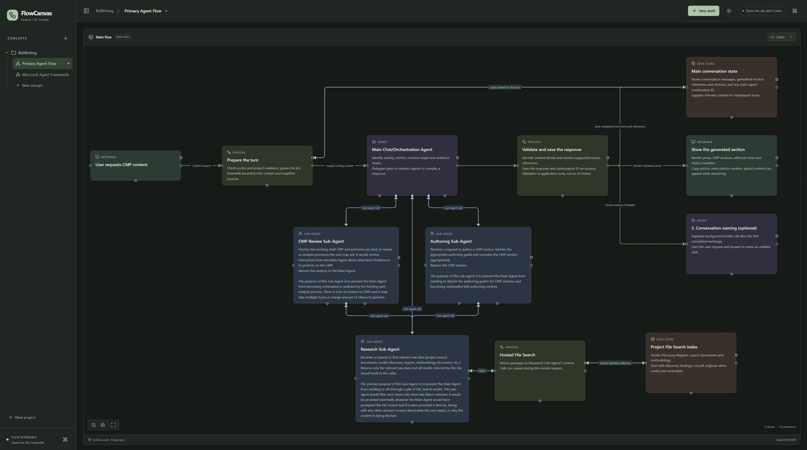

# FlowCanvas

A local visual workspace for sketching and discussing software and agent architecture with AI agents.

Create diagrams by hand, ask your agent to explore an alternative, and compare editable drafts with saved main versions. FlowCanvas supports the discussion around a design; it does not execute the agents or processes in a diagram.



## Features

- **Projects and Concepts:** organise related architecture diagrams in named workspaces.
- **Versioned main diagrams:** apply a draft to save an immutable version, then keep editing. Explore alternatives from any saved version.
- **Shared editing with agents:** read and edit drafts through a local Model Context Protocol (MCP) service. Applying a draft remains a manual browser action.
- **Purposeful connections:** distinguish normal flow, data requests, and sub-agent calls across six block types.
- **Canvas controls:** resize blocks, arrange diagrams, adjust connection routes, duplicate selections, and undo or redo edits.
- **Local persistence:** save Projects, Concepts, drafts, and history in SQLite, with a backup command for recovery.

## Requirements

- Node.js **22.12+ on the 22.x line, or 24+**, and npm. Windows is the primary development platform; other operating systems have not been verified.
- Git to clone the repository.
- Optional: an agent client that can reach a local **Streamable HTTP MCP** endpoint and send a bearer-token header. See [agent integration](docs/agents.md) for compatibility requirements.

The browser application can also run on its own. FlowCanvas does not require a model API key; your agent client manages its own model access.

## Quick start

```powershell
git clone https://github.com/avanillaslice/FlowCanvas.git
cd FlowCanvas
npm ci
npm run build
npm run up
```

Open [FlowCanvas at http://127.0.0.1:4317](http://127.0.0.1:4317).

`npm run up` starts the browser application and local MCP service, then checks the MCP connection. It does not install skills or change any agent configuration. Keep the terminal open; press **Ctrl+C** there to stop the service and close its database.

To connect an agent, manually add the MCP endpoint and its local credential in your client settings. Optionally copy the bundled `skills/flowcanvas` directory into a skills location supported by your client. Follow the [agent setup guide](docs/agents.md), or the [Codex example](docs/codex.md). Existing Codex connections and installed skills continue to work.

Subsequent launches need only `npm run up`. Rebuild after source updates and manually refresh your copied skill when its source changes.

`npm start` also serves the browser and MCP endpoint after a build, without running the launcher's connection check. Neither command requires Codex.

## First diagram

1. Create a **Project**, then a **Concept** inside it.
2. Create a draft and add blocks from the palette. Give each a short heading and connect related steps.
3. Choose **Arrange**, then adjust blocks or connections as needed.
4. Ask your connected agent: “Use FlowCanvas to read my current draft and help me sketch an alternative.” Use your client's skill invocation syntax to explicitly select the companion skill.
5. Click **Apply draft** to save main v1. The draft stays open; applying it again saves v2 and preserves v1.

The first browser tab supplies shared context. Use **Share this tab with agents** to explicitly share another tab. The indicator identifies the context supplied to tools; it does not mean an agent is continuously watching the canvas.

## Documentation

| Guide | Contents |
| --- | --- |
| [Canvas guide](docs/canvas.md) | Drafts, versions, connections, layout, shortcuts, and saving |
| [Agent integration](docs/agents.md) | Manual MCP and skill setup, compatibility, shared context, and inspection |
| [Codex example](docs/codex.md) | Manual Codex configuration and existing-connection guidance |
| [Local operation and recovery](docs/operations.md) | Startup, configuration, storage, backups, and restoration |
| [Development](docs/development.md) | Development server, checks, architecture, and repository layout |
| [Agent tool reference](skills/flowcanvas/references/tools.md) | MCP operations and graph editing examples |

## Common commands

Run these from the repository root.

| Command | Purpose |
| --- | --- |
| `npm run up` | Start FlowCanvas and verify its local MCP connection |
| `npm start` | Serve the built browser application and MCP endpoint |
| `npm run dev` | Start the development UI and service |
| `npm run build` | Type-check and build the UI and server |
| `npm test` | Run service, storage, routing, layout, and MCP tests |
| `npm run test:e2e` | Run browser tests against a built application |
| `npm run backup` | Create a timestamped SQLite backup |
| `npm run mcp:check` | Check the local MCP handshake and tool access |
| `npm run codex:check` | Optionally verify an existing Codex connection |

See the [development guide](docs/development.md#checks) for browser-test prerequisites and the [agent guide](docs/agents.md#connection-checks) for connection diagnostics.

## Scope

FlowCanvas supports local planning, plain multiline block notes, saved alternatives, and a local agent connection. Workflow execution, Markdown rendering, nested subflows, cloud collaboration, visual version diffs, and an export/import interface are not currently implemented.
