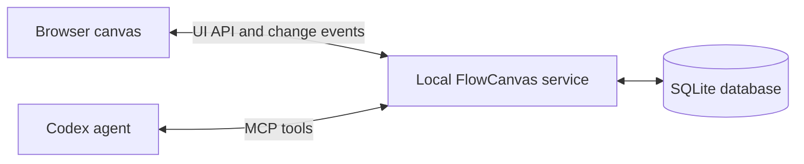

# Development

[Back to README](../README.md)

## Local development

```powershell
npm ci
npm run dev
```

Vite serves the browser at [http://127.0.0.1:5173](http://127.0.0.1:5173) and proxies `/api` to the service on port 4317, or `FLOWCANVAS_PORT` when set. Stop any existing service first. Development uses your regular data directory unless `FLOWCANVAS_DATA_DIR` is set; use an override for a separate workspace.

The UI updates through Vite. Restart `npm run dev` after server changes. This command does not configure Codex automatically; use the [connection helpers](codex.md#connection-checks) against the running service when needed. Keep one browser origin because tab identity is origin-specific.

## Checks

```powershell
npm test
npm run build
npx playwright install chromium
npm run test:e2e
```

- `npm test` runs Vitest checks for storage, versioning, conflicts, lifecycle, credentials, routing, layout, and MCP contracts.
- `npm run build` type-checks and emits the browser into `dist/web` and server into `dist/server`.
- `npx playwright install chromium` installs the browser for end-to-end tests; repeat when a Playwright upgrade requires it.
- `npm run test:e2e` requires a current build. It uses one worker and its own service on port 4318 with `.local/e2e-data`, refusing to reuse an existing listener.

Service tests use temporary databases; browser tests use their separate directory. Neither modifies the regular workspace. Browser scenarios cover version application, older-version alternatives, persistence, shared editing, connections, conflicts, tab isolation, and save recovery. Use current test output for counts.

Connection diagnostics require a running service and local Codex installation and are separate from the automated suite.

## Architecture

One Node.js service serves the built UI, handles UI requests and server-sent events, exposes `/mcp`, and owns SQLite. Browser and agent requests share application services and validation.



The browser uses React, TypeScript, Vite, and React Flow. The server uses Express, Zod, better-sqlite3, and the MCP TypeScript SDK. Automatic layout uses elkjs with application-specific routing and arrangement.

The shared tab reports its selection to the service; tools do not observe browser windows. Selection-based reads synchronise pending edits. Server-sent events notify the browser about changes and flush requests; reconnecting clients fetch authoritative state.

Drafts have revision counters and accept atomic command batches. Writes validate revisions and use operation IDs to deduplicate identical retries. Applying a draft is a separate UI operation that saves an immutable snapshot and advances the main version. MCP cannot edit main versions.

## Repository layout

| Path | Responsibility |
| --- | --- |
| `src/shared/` | Domain schemas, graph types, routing, and inspection contracts |
| `src/server/` | SQLite storage, services, browser ownership, UI API, MCP adapter, and lifecycle |
| `src/web/` | React workspace, canvas, editing controller, inspection, and themes |
| `public/` | Static browser assets |
| `scripts/` | Development, startup, shutdown, backups, skill installation, and connection helpers |
| `skills/flowcanvas/` | Companion skill and agent-facing references |
| `tests/` | Service and integration tests, fixtures, and browser scenarios under `e2e/` |
| `docs/` | User, integration, operation, and development guides |

Use `npm ci` for the dependency set in `package-lock.json`. Generated builds, dependencies, credentials, databases, and test output are excluded by `.gitignore`.

## MCP response contract

Reads return one JSON text payload rather than `structuredContent`. Graphs include complete nodes and edges with explicit connection kinds, omitting timestamps, coordinates, dimensions, and port handles. Empty text and labels are omitted. Nodes and edges are sorted by ID, not execution order.

References are complete without pagination. Workspace reference arrays exclude the selected diagrams already included in full; `read_concept` lists all references. Responses are schema-validated internally. `inspect_diagram` can also return a separate PNG image block.

New blocks may omit geometry, and connection kinds determine default ports. Keep the [agent tool reference](../skills/flowcanvas/references/tools.md) and companion skill consistent with MCP changes. Storage changes must preserve immutable history and back up databases before a versioned migration; see [database migrations](operations.md#database-migrations).
